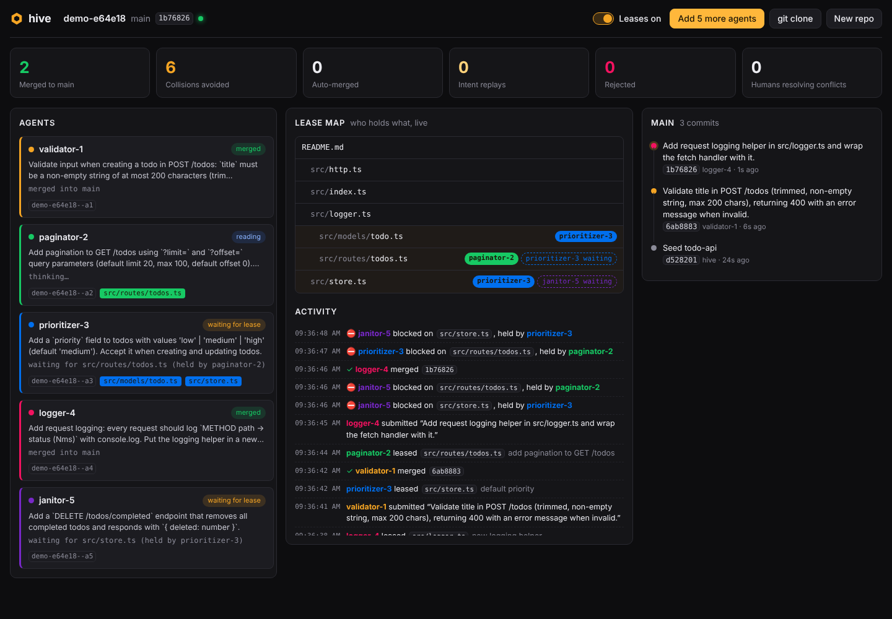

# Hive

**Many agents. One repo. No merge conflicts.**

Hive is a git platform for teams of AI agents that change the same codebase at the same time. It replaces
branches, pull requests and manual conflict resolution with three primitives built for agents:

1. **Leases.** Before editing a file, an agent leases it. Leases are live, short-lived and visible to every other
   agent, so most collisions are prevented before anyone writes a line.
2. **A fork per agent.** Every agent works in its own [Cloudflare Artifacts](https://developers.cloudflare.com/artifacts/)
   fork with a scoped, short-lived token. Forks are cheap, durable and disposable.
3. **Intents, not just diffs.** When an agent is done it submits an _intent_: one sentence on what it meant to do,
   plus the commit on its fork. A merge queue lands it on `main`, auto-merging (3-way) when other agents touched the
   same files. If the change genuinely conflicts, Hive **replays the intent**: it hands the agent the new `main` and
   asks it to redo the change. No human resolves anything.

Built for the Cloudflare "Build the next GitHub" challenge, on **Workers**, **Durable Objects** and **Artifacts**.

**Live:** https://hive.dangbinh4869.workers.dev



## The demo

Open the dashboard, create a demo repo (a small TODO API, seeded into Artifacts) and press **Run 5 agents**. Five
Claude agents get five overlapping tasks: validation, pagination, a new `priority` field, request logging and a
bulk-delete endpoint. Most of them need `src/routes/todos.ts` and `src/store.ts`.

- **Leases on:** agents queue for the files they need, the lease map lights up, and all five intents land on `main`
  in order. A typical run: 5 merges, ~6 collisions avoided, 0 conflicts, about 90 seconds.
- **Leases off:** agents edit blindly in parallel. The merge queue auto-merges what it can, detects real conflicts,
  and replays those intents on the new `main`. A typical run: 5 merges, 2 auto-merges, 1 replay, still zero humans.

Every change is a real git commit in Artifacts. Press **git clone** to get a read-only clone command for the repo.

## How it works

```
 Dashboard (React) ◄── WebSocket ── RepoCoordinator (Durable Object, one per repo)
                                     │  lease table · merge queue · event log
 HiveAgent (Durable Object, one     │  sole writer to main (isomorphic-git)
 per agent, Claude tool-use loop) ──┤
        │ read main (binding)        ▼
        │ push to own fork ───► Cloudflare Artifacts: <repo> (main) + <repo>--a1, <repo>--a2, …
```

- **`RepoCoordinator`** (one Durable Object per repo) creates the Artifacts repo, seeds it, forks it for each agent,
  mints scoped tokens, owns the lease table (expiry via DO alarms) and runs the merge queue. It is the only writer
  to `main`, which it keeps as an in-memory `isomorphic-git` clone. Every state change is broadcast to dashboards
  over hibernatable WebSockets.
- **`HiveAgent`** (one Durable Object per agent) runs a Claude tool-use loop from a DO alarm. Its tools are
  `list_files`, `read_file`, `request_lease`, `write_file` and `submit`. A granted lease returns the latest version
  of the file, which becomes the agent's merge base. `submit` clones the agent's fork, rebases it onto the latest
  `main`, commits, force-pushes the fork and enqueues the intent.
- **Merging** reads the agent's files from its fork commit (Artifacts binding `readFile`) and 3-way merges each file
  against the agent's base and the current `main` ([`packages/core/src/merge.ts`](packages/core/src/merge.ts)).
  Clean results are committed to `main` under the agent's name. Conflicts send the agent the current file contents
  so it can replay its intent, up to 3 attempts.

See [docs/DESIGN.md](docs/DESIGN.md) for the full design.

## Run it

Requirements: Node 22+, [Vite+](https://viteplus.dev) (`curl -fsSL https://vite.plus | bash`), a Cloudflare account
with Artifacts enabled, and an Anthropic API key.

```sh
vp install

# One-time: an Artifacts namespace called "hive"
curl -X POST "https://api.cloudflare.com/client/v4/accounts/$CLOUDFLARE_ACCOUNT_ID/artifacts/namespaces" \
  -H "Authorization: Bearer $CLOUDFLARE_API_TOKEN" -H "Content-Type: application/json" \
  -d '{"namespace":"hive"}'

# Local secrets for the Worker
cp apps/hive/.dev.vars.example apps/hive/.dev.vars   # then set ANTHROPIC_API_KEY

vp run dev          # dashboard + Worker on http://localhost:5173
```

Local development uses the remote Artifacts service (`"remote": true` on the binding), so Wrangler needs
`CLOUDFLARE_API_TOKEN` and `CLOUDFLARE_ACCOUNT_ID` in the environment (or `wrangler login`).

### Deploy

```sh
cd apps/hive
npx wrangler secret put ANTHROPIC_API_KEY
vp run deploy       # vp build && wrangler deploy
```

### Configuration

| Variable            | Where                                | Default           |
| ------------------- | ------------------------------------ | ----------------- |
| `ANTHROPIC_API_KEY` | secret / `.dev.vars`                 | required          |
| `HIVE_MODEL`        | `vars` in `apps/hive/wrangler.jsonc` | `claude-opus-5-5` |
| `HIVE_EFFORT`       | `vars` in `apps/hive/wrangler.jsonc` | `low`             |

### Checks

```sh
vp check            # format, lint, type-check
vp run -r test      # unit tests (leases, 3-way merge)
```

## API

| Method | Route                         | Description                                                |
| ------ | ----------------------------- | ---------------------------------------------------------- |
| POST   | `/api/repos`                  | Create a repo `{ name? }`, seeded with the demo code       |
| GET    | `/api/repos/:name/state`      | Agents, leases, intents, commits, stats, events            |
| GET    | `/api/repos/:name/ws`         | WebSocket: `{ event, state }` on every change              |
| POST   | `/api/repos/:name/scenario`   | Spawn agents `{ count? }` or `{ tasks: [{ name, task }] }` |
| POST   | `/api/repos/:name/settings`   | `{ leasesEnabled }`                                        |
| GET    | `/api/repos/:name/file?path=` | A file on `main`                                           |
| GET    | `/api/repos/:name/clone`      | A `git clone` command with a 1h read token                 |

## Layout

```
apps/hive/
  worker/          Worker entry (Hono), RepoCoordinator, HiveAgent, git helpers
  src/             Dashboard (React)
  seed/            The demo codebase every new repo starts from
packages/core/     Shared types, lease logic, 3-way file merge (+ tests)
```

## License

MIT
