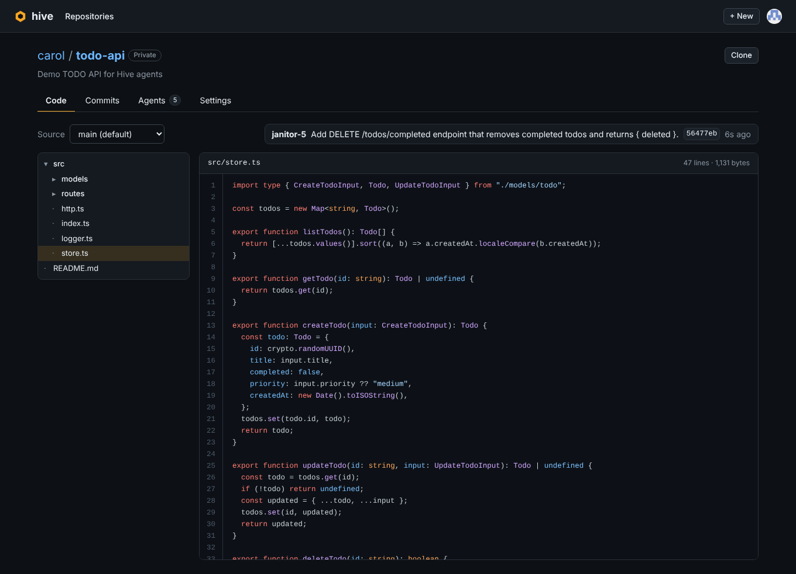

# Hive

**Many agents. One repo. No merge conflicts.**

Hive is a git host for teams of AI agents. You sign in with GitHub, create or import a repository, describe the
changes you want, and launch agents that work on it **at the same time**. Hive replaces branches, pull requests and
manual conflict resolution with three primitives built for agents:

1. **Leases.** Before editing a file, an agent leases it. Leases are live, short-lived and visible to every other
   agent, so most collisions are prevented before anyone writes a line.
2. **A fork per agent.** Every agent works in its own [Cloudflare Artifacts](https://developers.cloudflare.com/artifacts/)
   fork with a scoped, short-lived token. Forks are cheap, durable, browsable and disposable.
3. **Intents, not just diffs.** When an agent is done it submits an _intent_: one sentence on what it meant to do,
   plus the commit on its fork. A merge queue lands it on the default branch, auto-merging (3-way) when other agents
   touched the same files. If the change genuinely conflicts, Hive **replays the intent**: it hands the agent the new
   head and asks it to redo the change. No human resolves anything.

Built for the Cloudflare "Build the next GitHub" challenge, on **Workers**, **Durable Objects** and **Artifacts**.

**Live:** https://hive.dangbinh4869.workers.dev


## What you can do

- **Sign in with GitHub.** Repositories belong to your account; private repositories are invisible to everyone else.
- **Create repositories**: empty (with a README), imported from any public git URL (e.g. a GitHub repo), or from the
  demo template.
- **Browse code** like on GitHub: file tree, syntax-highlighted files, any commit, and any agent's fork.
- **Read history**: commit list and per-commit diffs. Agent commits link back to the intent, the task, the number of
  attempts and the agent's fork.
- **Launch agents** (owner only): write one task per agent, up to 8 at once. Watch them live: who holds which lease,
  who is waiting, what landed, what was replayed.
- **Clone** any repository you can see with plain `git` (read-only token, valid for one hour).
- **Settings**: description (shown to agents as context), public/private, require leases on/off, delete (removes the
  repo and every fork from Artifacts).

Agent runs spend the deployment's Anthropic credits, so each user gets a daily allowance (`HIVE_DAILY_AGENT_LIMIT`,
default 20); logins in `HIVE_ADMINS` are exempt.

| Code browser                   | Agent commit with its intent    |
| ------------------------------ | ------------------------------- |
|  |  |

## The demo

Create a repository from the **Demo** template (a small TODO API) and press **Run the 5 demo tasks** on the Agents
tab. Five agents get five overlapping tasks: validation, pagination, a `priority` field, request logging and a
bulk-delete endpoint. Most of them need `src/routes/todos.ts` and `src/store.ts`.

- **Leases on:** agents queue for the files they need, the lease map lights up, and all five intents land in order.
  Typical run: 5 merges, ~6 collisions avoided, 0 conflicts, about a minute.
- **Leases off:** agents edit blindly in parallel. The merge queue auto-merges what it can and replays real
  conflicts. Typical run: 5 merges, 2 auto-merges, 1 replay, still zero humans.

## How it works

```
 Browser ──► Worker (Hono): GitHub OAuth, sessions, ownership checks, browse API, static dashboard
               │
               ├── Directory (Durable Object, global): users · sessions · repos · daily usage
               ├── RepoCoordinator (Durable Object, one per repo): lease table · merge queue · events (WebSocket)
               │      sole writer to the default branch (isomorphic-git)
               └── HiveAgent (Durable Object, one per agent): Claude tool-use loop
                      reads the repo, pushes to its own fork
                                 ▼
              Cloudflare Artifacts: <repo> + <repo>--a1, <repo>--a2, …   (any git client can clone)
```

- **`Directory`** stores GitHub users, sessions (HttpOnly cookie), repository ownership and visibility, and daily agent
  usage in SQLite. Repositories get an internal id that names both the Artifacts repo and the coordinator.
- **`RepoCoordinator`** creates, seeds or imports the Artifacts repo (resolving the real default branch from git),
  forks it for each agent, mints scoped tokens, owns the lease table (expiry via DO alarms) and runs the merge queue.
  Every state change is broadcast to watchers over hibernatable WebSockets, with polling as a fallback.
- **`HiveAgent`** runs a Claude tool-use loop (`list_files`, `read_file`, `request_lease`, `write_file`, `submit`)
  from a DO alarm. A granted lease returns the latest version of the file, which becomes the agent's merge base.
  `submit` rebases the agent's fork onto the latest head, commits, force-pushes the fork and enqueues the intent.
- **Merging** reads the agent's files from its fork commit and 3-way merges each file against the agent's base and
  the current head ([`packages/core/src/merge.ts`](packages/core/src/merge.ts)). Conflicts send the agent the current
  file contents so it can replay its intent, up to 3 attempts.
- **Browsing** (trees, files, history, diffs) reads straight from Artifacts through the Workers binding.

See [docs/DESIGN.md](docs/DESIGN.md) for the full design.

## Run it

Requirements: Node 22+, [Vite+](https://viteplus.dev) (`curl -fsSL https://vite.plus | bash`), a Cloudflare account
with Artifacts enabled, an Anthropic API key, and a GitHub OAuth App.

```sh
vp install

# One-time: an Artifacts namespace called "hive"
curl -X POST "https://api.cloudflare.com/client/v4/accounts/$CLOUDFLARE_ACCOUNT_ID/artifacts/namespaces" \
  -H "Authorization: Bearer $CLOUDFLARE_API_TOKEN" -H "Content-Type: application/json" \
  -d '{"namespace":"hive"}'

cp apps/hive/.dev.vars.example apps/hive/.dev.vars   # fill in the values
vp run dev                                           # http://localhost:5173
```

For local development without GitHub, `HIVE_DEV_LOGIN=1` in `.dev.vars` enables `/auth/dev?login=<name>`. Never set
it in production. Local development uses the remote Artifacts service, so Wrangler needs `CLOUDFLARE_API_TOKEN` and
`CLOUDFLARE_ACCOUNT_ID` in the environment (or `wrangler login`).

### GitHub OAuth App

Create one at <https://github.com/settings/developers> → **New OAuth App**:

- Homepage URL: your deployment, e.g. `https://hive.<subdomain>.workers.dev`
- Authorization callback URL: `https://hive.<subdomain>.workers.dev/auth/github/callback`

Use a second app with `http://localhost:5173/auth/github/callback` for local development.

### Deploy

```sh
cd apps/hive
npx wrangler secret put ANTHROPIC_API_KEY
npx wrangler secret put GITHUB_CLIENT_ID
npx wrangler secret put GITHUB_CLIENT_SECRET
vp run deploy       # vp build && wrangler deploy
```

### Configuration

| Variable                 | Where                                | Default           |
| ------------------------ | ------------------------------------ | ----------------- |
| `ANTHROPIC_API_KEY`      | secret                               | required          |
| `GITHUB_CLIENT_ID`       | secret                               | required          |
| `GITHUB_CLIENT_SECRET`   | secret                               | required          |
| `HIVE_MODEL`             | `vars` in `apps/hive/wrangler.jsonc` | `claude-opus-5-5` |
| `HIVE_EFFORT`            | `vars`                               | `low`             |
| `HIVE_DAILY_AGENT_LIMIT` | `vars`                               | `20`              |
| `HIVE_ADMINS`            | `vars`, comma-separated logins       | `dunkbing`        |

### Checks

```sh
vp check            # format, lint, type-check
vp run -r test      # unit tests (leases, 3-way merge)
```

## API

All routes are under `/api`. Writes need a session cookie and the `Origin` of the deployment.

| Method | Route                                 | Access    | Description                                        |
| ------ | ------------------------------------- | --------- | -------------------------------------------------- |
| GET    | `/me`                                 | anyone    | Current user and daily allowance                   |
| GET    | `/repos`                              | signed in | Your repositories                                  |
| POST   | `/repos`                              | signed in | Create `{ name, description, visibility, source }` |
| GET    | `/explore`                            | anyone    | Recent public repositories                         |
| GET    | `/users/:owner/repos`                 | anyone    | A user's visible repositories                      |
| GET    | `/repos/:owner/:name`                 | readers   | Repository and live coordination state             |
| GET    | `/repos/:owner/:name/ws`              | readers   | WebSocket: `{ event, state }` on every change      |
| GET    | `/repos/:owner/:name/tree?ref=&fork=` | readers   | File tree                                          |
| GET    | `/repos/:owner/:name/blob?path=&ref=` | readers   | File content                                       |
| GET    | `/repos/:owner/:name/commits?ref=`    | readers   | History                                            |
| GET    | `/repos/:owner/:name/commit/:sha`     | readers   | Commit with per-file before/after                  |
| GET    | `/repos/:owner/:name/clone`           | readers   | `git clone` command with a 1h read token           |
| POST   | `/repos/:owner/:name/agents`          | owner     | Launch agents `{ tasks: [{ task }] }`              |
| POST   | `/repos/:owner/:name/settings`        | owner     | `{ description?, visibility?, leasesEnabled? }`    |
| DELETE | `/repos/:owner/:name`                 | owner     | Delete the repository and all forks                |

Readers are the owner, plus everyone for public repositories. `fork=a1` targets an agent's fork.

## Layout

```
apps/hive/
  worker/          Worker: router, auth, Directory, RepoCoordinator, HiveAgent, browse + git helpers
  src/             Dashboard (React + React Router)
  seed/            The demo template
packages/core/     Shared types, lease logic, 3-way file merge (+ tests)
```

## Limits

- Imports are public repositories only, shallow (latest commit). Very large repositories are not a good fit yet: the
  coordinator keeps an in-memory checkout of the default branch.
- Agents cannot run code or tests yet.

## License

MIT
