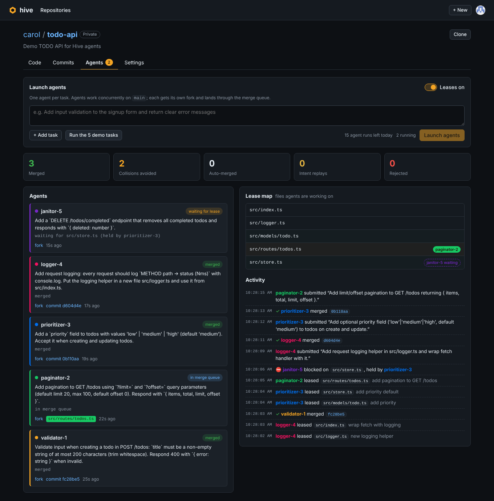
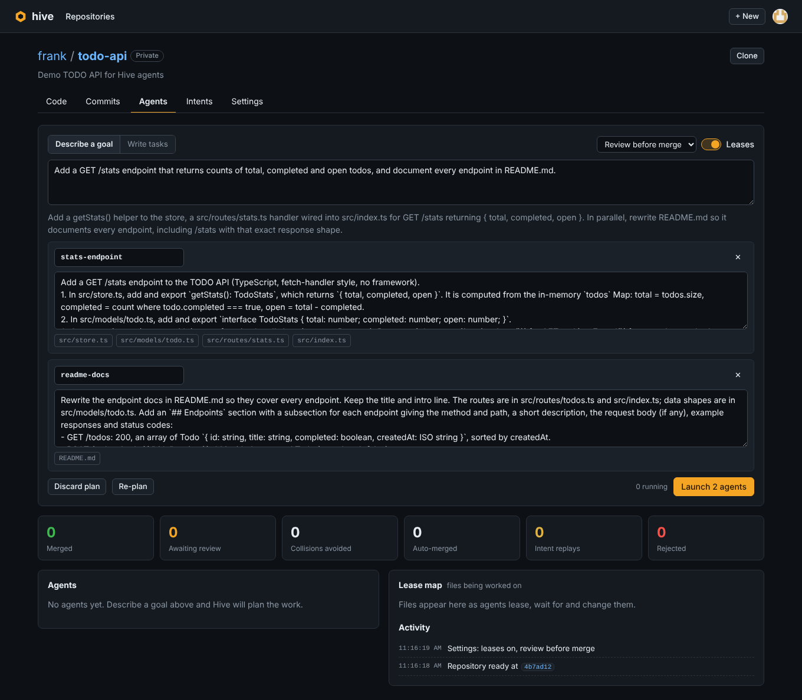
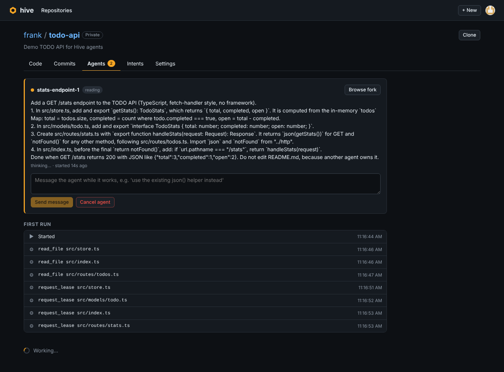
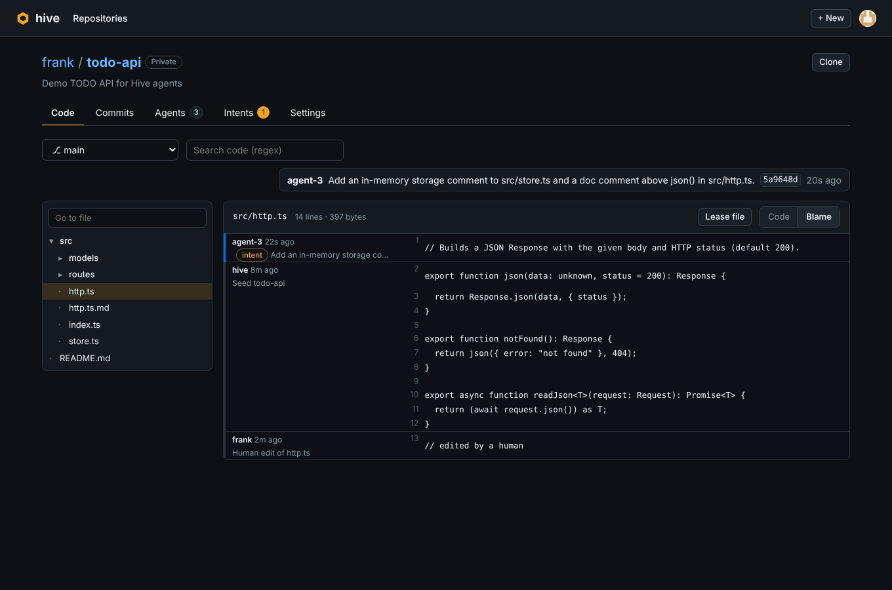
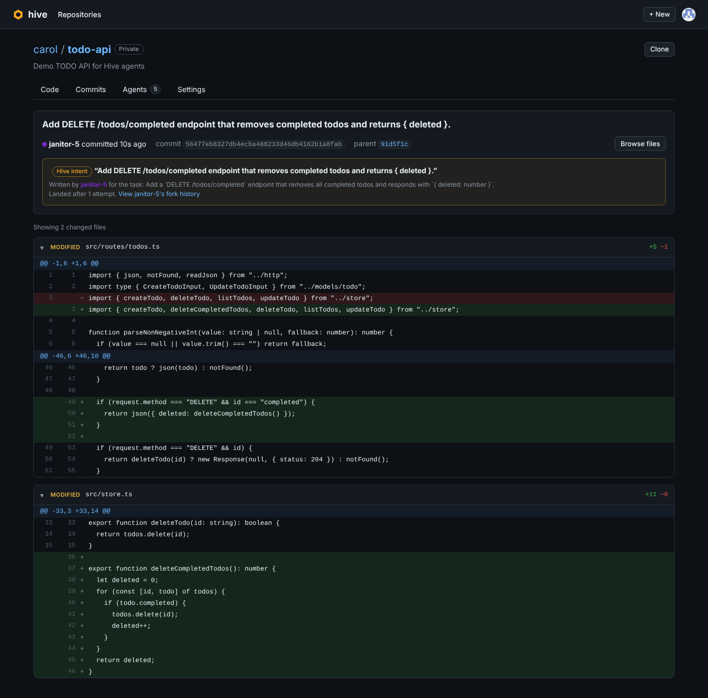

# Hive

**Many agents. One repo. No merge conflicts.**

Hive is a git host for teams of AI agents. You sign in with GitHub, create or import a repository, describe the
changes you want, and launch agents that work on it **at the same time**. Hive replaces branches, pull requests and
manual conflict resolution with three primitives built for agents:

1. **Leases.** Before editing a file, an agent leases it. Leases are live, short-lived and visible to every other
   agent, so most collisions are prevented before anyone writes a line.
2. **A fork per agent.** Every agent works in its own [Cloudflare Artifacts](https://developers.cloudflare.com/artifacts/)
   fork with a scoped, short-lived token. Forks are cheap, durable, browsable and disposable.
3. **Intents, not just diffs.** When an agent is done it submits an _intent_: one sentence on what it meant to do,
   plus the commit on its fork. A merge queue lands it on the default branch, auto-merging (3-way) when other agents
   touched the same files. If the change genuinely conflicts, Hive **replays the intent**: it hands the agent the new
   head and asks it to redo the change. No human resolves anything.

Built for the Cloudflare "Build the next GitHub" challenge, on **Workers**, **Durable Objects** and **Artifacts**.

**Live:** https://hive.dangbinh4869.workers.dev



## What you can do

**Work with agents**

- **Describe a goal.** A planner agent explores the repository and proposes parallel tasks, one agent each, with the
  files every task will touch (shared files are flagged: those agents take turns). Edit the plan, then launch. You can
  also write tasks yourself.
- **Watch them work.** The Agents tab shows who holds which lease, who is waiting, what landed and what was replayed.
  Every agent has a transcript: its reasoning, every file it read, searched, leased and edited, and the merge result.
- **Steer them.** Message a running agent (it reads the message on its next step) or a finished one (it starts a new
  run). Cancel an agent at any time; its leases are released.
- **Review before merge** (optional, per repository). Intents wait on the Intents tab with the agent's full diff.
  Approve and merge, request changes (the agent revises the same intent), or reject. Revert any merged intent with
  one click.
- **Verify before merge** (optional, per repository). A check command (for example `npm ci && npm test`) runs in a
  fresh Linux sandbox against the exact tree that would land. A failing check goes back to the agent with the output
  instead of merging.

**Work like on GitHub**

- **Sign in with GitHub.** Repositories belong to your account; private repositories are invisible to everyone else.
- **Create repositories**: empty, imported with full history from any public git URL, or from the demo template.
- **Browse code**: file tree with go-to-file, regex code search, syntax highlighting, rendered Markdown, blame (every
  line links to its commit and the intent behind it), any branch, tag, commit or agent fork.
- **History**: commit list and per-commit diffs; agent commits link to the intent, the task and the agent's transcript.
- **Work alongside agents**: owners get a read-write clone token and can push by hand; Hive picks up their commits
  before the next merge. Lease a file from the Code tab and agents work around it while you edit.
- **Round trip with GitHub** (imported repositories): open a pull request on the source repository with everything
  merged in Hive, and sync new upstream commits back in (3-way per file).

Agent runs spend the deployment's Anthropic credits, so each user gets a daily allowance (`HIVE_DAILY_AGENT_LIMIT`,
default 20; planning, messages and change requests count as one run); logins in `HIVE_ADMINS` are exempt.

| Planning a goal          | An agent's transcript               |
| ------------------------ | ----------------------------------- |
|    |   |
| **Blame by intent**      | **An agent commit with its intent** |
|  |      |

## The demo

Create a repository from the **Demo** template (a small TODO API) and press **Run the 5 demo tasks** on the Agents
tab. Five agents get five overlapping tasks: validation, pagination, a `priority` field, request logging and a
bulk-delete endpoint. Most of them need `src/routes/todos.ts` and `src/store.ts`. Demo repositories type-check every
merge in a sandbox by default.

- **Leases on:** agents queue for the files they need, the lease map lights up, and all five intents land in order.
  Typical run: 5 merges, ~6 collisions avoided, 0 conflicts, about a minute.
- **Leases off:** agents edit blindly in parallel. The merge queue auto-merges what it can and replays real
  conflicts. Typical run: 5 merges, 2 auto-merges, 1 replay, still zero humans.
- **Or describe a goal** ("add user accounts with bearer-token auth") and let the planner split it.

## How it works

```
 Browser ──► Worker (Hono): GitHub OAuth, sessions, ownership checks, browse/blame/search API, planner, dashboard
               │
               ├── Directory (Durable Object, global): users · sessions · repos · sealed GitHub tokens · usage
               ├── RepoCoordinator (Durable Object, one per repo): leases · merge queue · review queue · events
               │      sole automated writer to the default branch (isomorphic-git), picks up human pushes
               ├── HiveAgent (Durable Object, one per agent): Claude tool-use loop · transcript · inbox
               │      reads the repo, pushes to its own fork
               └── HiveSandbox (container per check): runs the check command against the merged tree
                                 ▼
              Cloudflare Artifacts: <repo> + <repo>--a1, <repo>--a2, …   (any git client can clone)
```

- **`Directory`** stores GitHub users, sessions (HttpOnly cookie), repository ownership and visibility, AES-GCM sealed
  GitHub tokens, and daily agent usage in SQLite.
- **`RepoCoordinator`** creates, seeds or imports the Artifacts repo, forks it for each agent, mints scoped tokens,
  owns the lease table (expiry via DO alarms), the merge queue and the review queue, and runs checks. Every state
  change is broadcast over hibernatable WebSockets, with polling as a fallback.
- **`HiveAgent`** runs a Claude tool-use loop (`list_files`, `search`, `read_file`, `request_lease`, `edit_file`,
  `write_file`, `delete_file`, `submit`) from a DO alarm and records every step. A granted lease returns the latest
  version of the file, which becomes the agent's merge base. `submit` rebases the agent's fork onto the latest head,
  commits, force-pushes the fork and submits the intent. Revisions (review comments, conflicts after approval,
  failed checks, messages) start new runs that continue the same intent.
- **Merging** syncs with the remote, reads the agent's files from its fork commit and 3-way merges each file against
  the agent's base and the current head ([`packages/core/src/merge.ts`](packages/core/src/merge.ts)), deletions
  included. With a check command, the merged tree is committed locally, packed as a tar archive, checked in a
  sandbox, and only pushed if it passes.
- **Browsing** (trees, files, history, diffs, blame) reads straight from Artifacts through the Workers binding.
- **GitHub pull requests** are built with the git data API: Hive compares its head tree with the last synced upstream
  tree by blob id, uploads only changed blobs and opens a PR from a new branch.

See [docs/DESIGN.md](docs/DESIGN.md) for the full design.

## Run it

Requirements: Node 22+, [Vite+](https://viteplus.dev) (`curl -fsSL https://vite.plus | bash`), a Cloudflare account
with Artifacts enabled, an Anthropic API key, and a GitHub OAuth App.

```sh
vp install

# One-time: an Artifacts namespace called "hive"
curl -X POST "https://api.cloudflare.com/client/v4/accounts/$CLOUDFLARE_ACCOUNT_ID/artifacts/namespaces" \
  -H "Authorization: Bearer $CLOUDFLARE_API_TOKEN" -H "Content-Type: application/json" \
  -d '{"namespace":"hive"}'

cp apps/hive/.dev.vars.example apps/hive/.dev.vars   # fill in the values
vp run dev                                           # http://localhost:5173
```

For local development without GitHub, `HIVE_DEV_LOGIN=1` in `.dev.vars` enables `/auth/dev?login=<name>`. Never set
it in production. Local development uses the remote Artifacts service, so Wrangler needs `CLOUDFLARE_API_TOKEN` and
`CLOUDFLARE_ACCOUNT_ID` in the environment (or `wrangler login`).

### GitHub OAuth App

Create one at <https://github.com/settings/developers> → **New OAuth App**:

- Homepage URL: your deployment, e.g. `https://hive.<subdomain>.workers.dev`
- Authorization callback URL: `https://hive.<subdomain>.workers.dev/auth/github/callback`

Use a second app with `http://localhost:5173/auth/github/callback` for local development.

### Deploy

```sh
cd apps/hive
npx wrangler secret put ANTHROPIC_API_KEY
npx wrangler secret put GITHUB_CLIENT_ID
npx wrangler secret put GITHUB_CLIENT_SECRET
vp run deploy       # vp build && wrangler deploy
```

### Configuration

| Variable                 | Where                                | Default           |
| ------------------------ | ------------------------------------ | ----------------- |
| `ANTHROPIC_API_KEY`      | secret                               | required          |
| `GITHUB_CLIENT_ID`       | secret                               | required          |
| `GITHUB_CLIENT_SECRET`   | secret                               | required          |
| `HIVE_MODEL`             | `vars` in `apps/hive/wrangler.jsonc` | `claude-opus-5-5` |
| `HIVE_EFFORT`            | `vars`                               | `low`             |
| `HIVE_DAILY_AGENT_LIMIT` | `vars`                               | `20`              |
| `HIVE_ADMINS`            | `vars`, comma-separated logins       | `dunkbing`        |

### Checks

```sh
vp check            # format, lint, type-check
vp run -r test      # unit tests (leases, 3-way merge)
```

## API

All routes are under `/api`. Writes need a session cookie and the `Origin` of the deployment.

| Method | Route                                 | Access    | Description                                        |
| ------ | ------------------------------------- | --------- | -------------------------------------------------- |
| GET    | `/me`                                 | anyone    | Current user and daily allowance                   |
| GET    | `/repos`                              | signed in | Your repositories                                  |
| POST   | `/repos`                              | signed in | Create `{ name, description, visibility, source }` |
| GET    | `/explore`                            | anyone    | Recent public repositories                         |
| GET    | `/users/:owner/repos`                 | anyone    | A user's visible repositories                      |
| GET    | `/repos/:owner/:name`                 | readers   | Repository and live coordination state             |
| GET    | `/repos/:owner/:name/ws`              | readers   | WebSocket: `{ event, state }` on every change      |
| GET    | `/repos/:owner/:name/tree?ref=&fork=` | readers   | File tree                                          |
| GET    | `/repos/:owner/:name/blob?path=&ref=` | readers   | File content                                       |
| GET    | `/repos/:owner/:name/commits?ref=`    | readers   | History                                            |
| GET    | `/repos/:owner/:name/commit/:sha`     | readers   | Commit with per-file before/after                  |
| GET    | `/repos/:owner/:name/clone`           | readers   | `git clone` command with a 1h read token           |
| POST   | `/repos/:owner/:name/agents`          | owner     | Launch agents `{ tasks: [{ task }] }`              |
| POST   | `/repos/:owner/:name/settings`        | owner     | `{ description?, visibility?, leasesEnabled? }`    |
| DELETE | `/repos/:owner/:name`                 | owner     | Delete the repository and all forks                |

Readers are the owner, plus everyone for public repositories. `fork=a1` targets an agent's fork.

## Layout

```
apps/hive/
  worker/          Worker: router, auth, Directory, RepoCoordinator, HiveAgent, browse + git helpers
  src/             Dashboard (React + React Router)
  seed/            The demo template
packages/core/     Shared types, lease logic, 3-way file merge (+ tests)
```

## Limits

- Imports are public repositories only. Very large repositories are not a good fit yet: the coordinator keeps an
  in-memory checkout of the default branch.
- Agents cannot run code themselves; the check command is their feedback loop.
- GitHub sync skips binary files and stops when a file conflicts; it does not resolve conflicts for you.

## License

MIT
